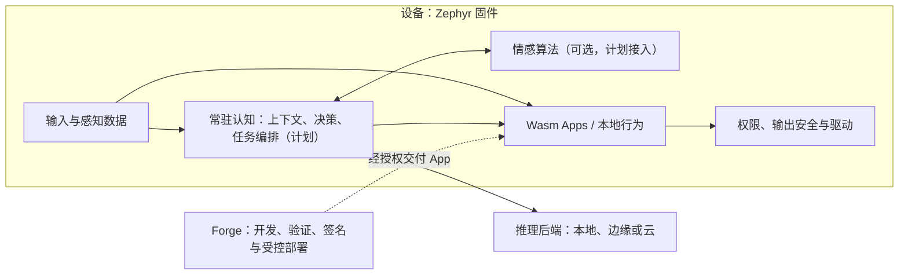
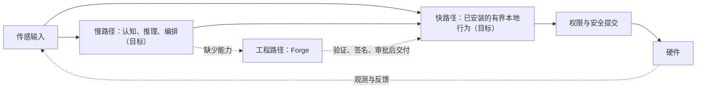

# 架构与实现边界

本文面向框架开发者，描述当前实现和目标设计；目标设计不是已有功能或
已经批准的接口合同。设备安全边界以[安全不变量](safety.md)为准。

## 职责与部署

Body、Cognition、Factory 是**逻辑职责**，不意味着三个独立设备。目标架构中，
Body 和常驻 Cognition 都位于 Zephyr；可选情感模块也在设备内。推理服务可以
位于设备、边缘节点或云端，Forge 始终是独立的工程制造系统。

常驻认知应负责有界的本地状态、任务生命周期、推理请求协调和执行反馈。
推理网络或模型不可用时，安全与已配置的本地行为不能依赖其返回；
依赖远程推理的任务则应明确暂停或失败。认知与安全同处固件也不意味着共用
阻塞执行线程；线程、队列及资源预算尚待目标板验证和设计。

## 三条路径

- **快路径**不应等待模型或网络。当前有本地 Wasm App；完整反射框架和
  实时延迟保证尚未实现或测量。
- **慢路径**计划协调推理、结构化意图、行为与反馈。Lua 临时执行、资源
  限额、取消和失效机制均未实现。
- **工程路径**由 Forge 开发、测试和交付复杂能力；Forge 不在线不应妨碍
  设备已安装的本地行为。

收到或接受命令不等于物理动作完成；需要相应的设备观测才可确认。

## 当前实现

| 模块 | 当前状态 |
| --- | --- |
| 固件 | `firmware/module/tessera` 保留 `ts_*` 兼容接口；WAMR 执行 Wasm App。 |
| App | 支持多实例，默认配置为一个；现有来源仲裁不等于多 App 通道所有权。 |
| 输出 | 普通输出经权限和安全提交路径；急停走独立路径。输入读取不经过输出提交。 |
| 情感 | `lib/affect/` 是单写者、单例 C 内核及主机测试；尚未链接至 Zephyr，也不是通用多实例插件。 |
| Forge | `agent/` 是独立仓库的 Git 子模块；支持独立源代码工作区。 |
| 尚未实现 | 常驻认知、Lua、通道所有权、类型化完成回执及情感生命周期。 |

目标板的媒体、控制、内存及延迟预算必须实测。历史设计文档的来源见
[迁移出处](provenance.md)，不自动构成当前需求。
