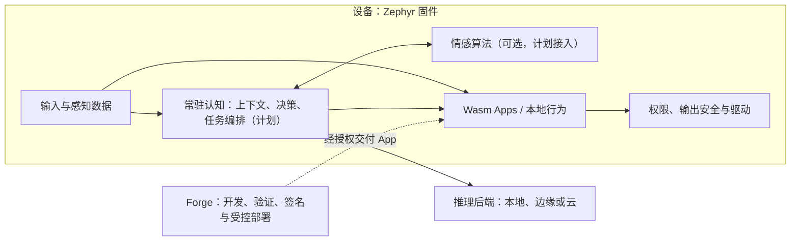
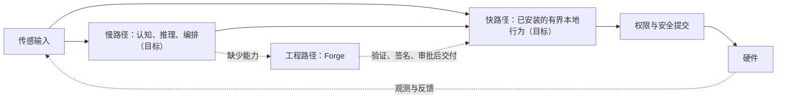

# 架构与实现边界

本文面向框架开发者，描述当前实现和目标设计；目标设计不是已有功能或
已经批准的接口合同。项目功能需求和进度以[功能需求与总进度](requirements.md)
为准，设备安全边界以[安全不变量](safety.md)为准。

新一轮[框架定义](internal/p05-framework.md)已确认默认 Zephyr MCU 与原生 Linux
运行时、共享语义及按需装配智脑模块。详细设计尚未冻结；本文下方保留
既有实现与旧目标说明，不将新的双平台方向冒充已经完成的架构接线。

## 职责与部署

Body、Cognition、Factory 是**逻辑职责**，不意味着三个独立设备。目标架构中，
Body 和常驻 Cognition 都位于 Zephyr；可选情感模块也在设备内。推理服务可以
位于设备、边缘节点或云端，Forge 始终是独立的工程制造系统。

常驻认知应负责有界的本地状态、任务生命周期、推理请求协调和执行反馈。
推理网络或模型不可用时，安全与已配置的本地行为不能依赖其返回；
依赖远程推理的任务则应明确暂停或失败。认知与安全同处固件也不意味着共用
阻塞执行线程；线程、队列及资源预算尚待目标板验证和设计。

## 框架、产品与研究

Entelea 维护通用设备运行时，Galatea 是其首个认知个体产品方向；产品装配
决定陪伴驱力、表达和主动性，不另建固件、安全层或常驻大脑。普通任务设备
不依赖这些产品行为。装配接口与运行实现尚待后续模块完成，不能把文档中的
产品配置当作已经存在的可加载插件。

原 Galatea 的 Python、MW0、学习实验和独立评价保留在研究仓库，不成为
设备或 Forge 的运行依赖。经过筛选的算法、合同与测试进入本仓库后，必须
按目标配置重新验证；研究门退出不能直接计作产品完成。
模块映射及未来范围见 [Galatea 产品与研究边界](galatea.md)。

认知接线继承以下语义边界：

- 观测、推断、预测、想象和外部陈述保留来源、时效和有效性，不以缺失值
  冒充正常状态；模型结果不能直接升级为设备观测。
- 请求先成为候选，由设备检查能力、资源、权限和时效；合法授权任务可
  作为充分的采纳理由，不照搬研究中必须存在非请求动机的 C5 前置条件。
- Galatea 的主动候选仍受用户任务、勿扰、配额、取消和通道所有权约束；
  情感、工作空间和模型均不能直接写输出或提升权限。
- 最小自身状态视图来自能力、任务和回执，不等同于自我意识；接收、执行
  和观测完成继续分离。已有安全与来源仲裁合同不变。

## 三条路径

- **快路径**不应等待模型或网络。当前有本地 Wasm App；完整反射框架和
  实时延迟保证尚未实现或测量。
- **慢路径**计划协调推理、结构化意图、行为与反馈。Lua 临时执行、资源
  限额、取消和失效机制均未实现。
- **工程路径**由 Forge 开发、测试和交付复杂能力；Forge 不在线不应妨碍
  设备已安装的本地行为。

收到或接受命令不等于物理动作完成；需要相应的设备观测才可确认。

## 当前实现

| 模块 | 当前状态 |
| --- | --- |
| 固件 | `firmware/module/tessera` 保留 `ts_*` 兼容接口；WAMR 执行 Wasm App。 |
| App | 支持多实例，默认配置为一个；现有来源仲裁不等于多 App 通道所有权。 |
| 输出 | 普通输出经权限和安全提交路径；急停走独立路径。输入读取不经过输出提交。 |
| 情感 | `lib/affect/` 是单写者、单例 C 内核及主机测试；尚未链接至 Zephyr，也不是通用多实例插件。 |
| Forge | `agent/` 是独立仓库的 Git 子模块；支持独立源代码工作区。 |
| 尚未实现 | 常驻认知、Lua、通道所有权、类型化完成回执及情感生命周期。 |

目标板的媒体、控制、内存及延迟预算必须实测。历史设计文档的来源见
[迁移出处](provenance.md)，不自动构成当前需求。
