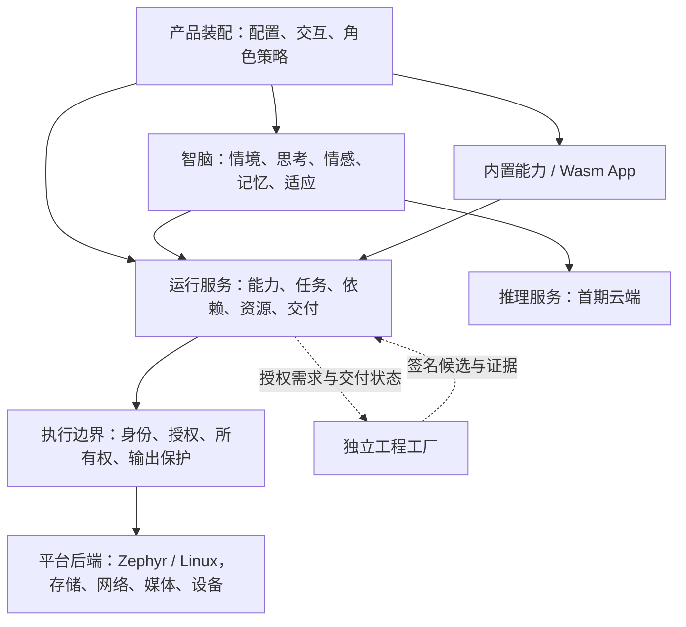

# P05 框架设计建议：总览、治理与迁移

2026-11-07。**供 owner review 的建议稿，不是已冻结架构或实现证据。**
前提以[框架共识](p05-framework.md)、[首产品范围](p05-first-product.md)
和[安全不变量](../safety.md)为准；[需求进度](../requirements.md)仍是唯一台账。
本稿不修改既有验收状态，不自动批准依赖、ABI、信任或硬件操作。

## 1. 阅读路径与核心建议

| 想 review 的内容 | 文档 |
| --- | --- |
| 总体结构、取舍、首期边界、AI 开发治理、迁移与待确认项 | 本文 |
| 基础合同、能力/任务/授权、App、依赖、调度、媒体与故障 | [设备运行时](p05-design-runtime.md) |
| 智脑、情境、思考、情感、经历记忆与长期适应 | [认知与记忆](p05-design-cognition.md) |
| 工程工厂、候选、试用/确认、配置与凭据生命周期 | [工程交付](p05-design-delivery.md) |

推荐以**模块化单体**构建设备运行时：小而明确的公共合同，
可裁剪的逻辑模块，Zephyr/Linux 独立后端，产品在最上层装配。
模块不等于 App、线程或服务；核心不是第二套操作系统。
认知模块有实际状态与因果作用，不把整台设备降为一段提示词。
外部工程工厂保留独立版本和故障域，不成为运行时智脑或所有 App 的依赖。

文中“推荐”均等待确认；三个维度独立、离线智能停用、用户验收、
经历存储要求及媒体边界等已确认前提不重新解释为可选建议。
旧命名只用于现状映射；建议目录不恢复 Galatea/Tessera/Kaleido 并列项目。

## 2. 调研：学习大项目的约束，而非复制其规模

以下来源本轮直接读取；只概括与本项目相关的机制，不复制上游实现。

| 样本与证据 | 学到的机制 | 本项目采用/拒绝及理由 |
| --- | --- | --- |
| Linux [维护者入口](https://www.kernel.org/doc/html/latest/maintainer/maintainer-entry-profile.html)、[子系统流程](https://www.kernel.org/doc/html/latest/process/maintainer-handbooks.html) | 通用贡献纪律与子系统特殊约束分开；明确测试/审核入口 | 采用每模块清晰边界与必要局部入口；不照搬维护者组织和多级发布树 |
| Zephyr [应用构建](https://docs.zephyrproject.org/latest/develop/application/index.html)、[外部模块](https://docs.zephyrproject.org/latest/develop/modules.html) | 应用装配控制最终镜像；外部依赖有独立生命周期 | 产品配置裁剪组件，固定依赖和补丁；不为每个逻辑模块开新仓库 |
| Chromium [checkdeps](https://chromium.googlesource.com/chromium/src/+/main/buildtools/checkdeps/README.md)、[code reviews](https://chromium.googlesource.com/chromium/src/+/HEAD/docs/code_reviews.md) | include 规则可机械检查，允许受控旧债；评审职责明确 | 采用构建 target/头文件可见性和增量禁止新越界；不复制其目录/审核人数规模 |
| Kubernetes [controllers](https://kubernetes.io/docs/concepts/architecture/controller/) | 期望与实际状态分开，每个协调器负责明确对象 | 用于 App/依赖/交付协调；不引入 API server、etcd 或分布式控制平面；不把硬件未知副作用自动重试 |
| ROS 2 [managed nodes](https://design.ros2.org/articles/node_lifecycle.html) | 配置、激活、停用和失败有显式生命周期 | 借鉴准备/运行分离；不要求 DDS、ROS 节点或每模块进程，不照搬全部状态 |
| SQLite [测试](https://sqlite.org/testing.html)、[atomic commit](https://sqlite.org/atomiccommit.html) | 分配/IO/中断故障注入；提交保证依赖介质与同步假设 | 采用存储边界注入和逐提交点恢复验证；不因使用日志/双副本便声称 FAT/TF 具有相同保证 |
| PipeWire [概念](https://docs.pipewire.org/page_overview.html) | 执行机制与情境策略分离，控制对象有明确权限 | 产品选表达/路由，媒体后端执行；不在 MCU 重建桌面媒体图 |
| GStreamer [queue](https://gstreamer.freedesktop.org/documentation/coreelements/queue.html) | 缓冲满策略、线程与延迟互相影响 | 有界数据面单独预算；不照搬默认 200 buffers/10 MB/1 s 或每阶段线程 |
| Anthropic [长任务 harness](https://www.anthropic.com/research/effective-harnesses-for-long-running-agents) | 跨上下文恢复、增量推进、独立测试防止过早宣称完成 | 复用需求台账/版本证据/会话交接，不再加一套重复进度文件；这是厂商实验，不是硬件可靠性保证 |
| LangGraph [memory overview](https://docs.langchain.com/oss/python/concepts/memory) | 工作上下文与跨会话记忆不同，长上下文不等于好记忆 | 采用有界上下文与选择性检索；不搬数据库/检查点框架，也不把其 memory 等同 Galatea 的经历机制 |
| WAMR [memory usage](https://raw.githubusercontent.com/bytecodealliance/wasm-micro-runtime/main/doc/memory_usage.md) | 线性内存、模块、执行环境与宿主栈分别占资源 | 全成本入账；该文假定 AOT/WASI 等配置，不能把估算直接用于当前解释器/Zephyr 配置 |
| Zephyr [NVS](https://docs.zephyrproject.org/latest/services/storage/nvs/nvs.html) | 元数据/数据校验、写顺序、磨损和格式升级有条件 | 存储合同声明粒度和恢复边界；不默认替换已有分区后端或依赖 NVS |

`latest`/`main` 来源会变化，实施时固定版本并复核。
OpenAI harness 页面本轮 403，不作为关键结论的直接证据；
ROS QoS 页面读取失败，不据此承诺传输质量或引入 ROS。
上述项目并非都由 AI 开发；本稿分别借鉴成熟工程机制与 AI 工作流实验，
不声称已有证据证明“完全 AI 开发大型机器人框架”普遍可靠。

## 3. 系统边界与分层



图示是职责/调用关系，不是线程图。具体模块依赖规则：

| 层/域 | 包含 | 编译依赖约束 |
| --- | --- | --- |
| 公共合同 | 标识、时间/来源、错误、请求/回执；模块各自端口类型 | 无 Zephyr/Linux/WAMR/产品头；不集中所有业务 schema |
| 运行机制 | 能力、任务、依赖、资源、授权、安全、App/交付、观测 | 依赖合同与明确服务端口，不依赖认知/产品实现 |
| 认知与扩展 | 情境/思考/记忆/情感/适应；媒体类型与控制 | 依赖运行端口；认知不能直达硬件/原始传输 |
| 平台适配 | OS、设备、存储、传输、WAMR、媒体处理 | 实现所属模块公开端口，可包含相应端口头；不包含上层私有实现 |
| 产品装配 | 模块选择、预算、角色、交互入口和策略 | 唯一允许集中连线的 composition root；业务状态仍归所属模块 |
| 工程工厂 | 创作/验证/签名/交付工具 | 通过版本化契约交换，不链接设备内部实现 |

“平台层低”指副作用位置，不要求适配器只依赖最基础头文件：
音频适配器需要音频端口，存储适配器需要存储端口。
区分**接口依赖图、运行调用图、数据反馈图**，反馈不能成为循环 include。
优先函数/显式上下文；只有后端替换、异步边界或测试缝需要 ops，
不建设万能 service locator、反射系统或统一插件框架。

## 4. 推荐首期装配与实现深度

| 配置 | 推荐交付 | 不承诺 |
| --- | --- | --- |
| MCU 辅助智能 | 设备状态分析闭环、授权低风险操作、断联/重复/云故障；无媒体/情感/经历依赖 | 第二个完整消费产品、跨设备控制实机完成 |
| MCU 模拟智能参考产品 | 既定五场景、经历连续性、受控行动和新能力交付；资源按当前板实测 | 原 Kaleido 全部 backlog、数个月成长已验收 |
| Linux 首期宿主 | 原生无界面最小可运行宿主，运行同一适用合同代码、内置测试能力及一个受限 Wasm App；脚本化生命周期/故障重放 | 完整认知产品、所有媒体驱动、本地 LLM 或与 MCU 相同隔离强度 |

Linux 比“只交叉编译”多一个行为闭环，但不与 MCU 产品并行建设完整脑。
推荐 C 实现公共合同/确定性机制，Linux 原生宿主以同源库连接后端；
Python 保留工程和研究用途，不先形成第二套生产任务/权限状态机。
后续高算力认知可以采用其他语言进程，但必须证明收益、隔离和契约成本。

推荐首期动态 App 只用现有 Wasm；内置能力以编译装配复用同一调用合同。
Lua 暂缓实现，保留旧需求未实现记录，不默认用“结构化计划”替代已批准 Lua。
是否接受这项范围变更由 owner 决定；未来脚本不拥有另一套权限/任务系统。
媒体接口开发可超出首产品，但只有验证过的后端进入支持矩阵。
记忆/情感编译时可选；运行时禁用不是二进制热卸载。

## 5. 面向 AI 的软件组织管理

1. **权威来源不重复。**需求/进度只维护现有台账；冻结后架构替代旧目标
   正文，而不是永久保留两套当前设计。协议细节以 schema/头文件和测试为准。
2. **按任务加载。**根入口只给边界与导航；普通 App 开发不读记忆算法；
   模块需要特殊纪律才有短局部入口。研究流水留会话，不进默认上下文。
3. **机械化职责边界。**建议构建 target 显式列源/公开头，检查禁止 include、
   下层产品依赖及 App 到驱动路径；既有违规列基线，只禁止新增，不靠全局例外。
4. **验收不能同源自证。**AI 写代码和测试可以，但冻结行为向量、
   用户场景及故障注入由独立合同约束；改期望/阈值需理由与 owner 确认。
5. **小批闭环。**一次围绕明确行为链和 owner；跨边界变更同时更新契约、
   两侧消费者和适用回归，不逐文件机械改名。不同目标才考虑并行代理。
6. **证据状态结构化。**每次报告代码版本、目标/配置、工具链、实际命令、
   通过/失败/跳过及原因；绿灯不合并为“设备已完成”。
7. **治理入口复用。**沿用当前 owner 与 CI，不设置虚构的人类团队；
   AI 辅助评审不取得风险授权或用户验收权。提交/发布由既有审批规则控制。
8. **debug/release 差异可检验。**开发便利有显式配置标识、有限预算，
   签名/授权/停止同样有效；日志脱敏不因 debug 失效。

这些是后续实施建议，本轮不增加检查脚本、定制指令或新依赖。

## 6. 建议目录：先形成库边界，再迁移路径

以下是**建议终态，尚未创建**，空目录不先落地：

```text
framework/
  include/entelea/       模块公开合同；旧 ts_* 薄兼容入口保留
  runtime/              生命周期、能力、任务、依赖、资源
  execution/            身份、授权、所有权及安全提交
  services/             App/交付、配置、观测；不成为万能 services 模块
  cognition/            context、deliberation、memory、affect、adaptation
  extensions/           audio、image、display 的合同与公共逻辑
platform/
  zephyr/               集成、OS/设备/存储/传输及 WAMR 后端
  linux/                原生宿主与后端
products/               辅助参考/模拟产品的装配配置，不另建安全层
firmware/               保留 Zephyr 应用入口、板卡与原测试入口
lib/affect/             既有算法先保留，使用适配层，不急于改名
agent/                 独立工程工厂子模块保留
tests/                 新公共合同向量/主机测试；原测试逐批映射
docs/                  短权威文档与按需主题，不复制源码 API 全文
```

选择新增公共库根而非把 Linux 放进 `firmware/module/tessera`，
使跨平台边界可见；代价是 CMake/测试入口迁移。更保守的备选是先在
现有模块内形成独立 target，验证边界后再移动，**推荐实际迁移采用此方式**。
目录终态与命名须确认；兼容层转发到一个实现，不长期维护两份状态。

### 现有资产映射

| 现有证据入口 | 推荐处理 | 保留条件 |
| --- | --- | --- |
| [应用 main](../../firmware/app/src/main.c)、[boot](../../firmware/module/tessera/src/core/boot.c) | 保留入口，后提取产品装配/监督职责 | 固定安全初始化顺序不擅改，网络未就绪不伪装完成 |
| [core.h](../../firmware/module/tessera/include/ts/core.h)、[events](../../firmware/module/tessera/src/core/events.c) | 提取时间/事件合同与 Zephyr 后端；旧 API 适配 | 同步回调/ISR 指针语义不能静默改成异步 |
| [权限/HAL](../../firmware/module/tessera/include/ts/hal.h)、[commit](../../firmware/module/tessera/src/safety/commit.c) | 保留保护实现；能力门与平台设备访问逐步分离 | 现有 GPIO/PWM/供电保护与来源仲裁不削弱 |
| [lease](../../firmware/module/tessera/src/net/lease.c) | 命令租约与 App 资源所有权分别建合同 | 当前租约不等于多 App 通道所有权 |
| [periph](../../firmware/module/tessera/src/periph/)、[power](../../firmware/module/tessera/src/power/) | 接能力目录与有界资源端口 | 先保留现有注册、故障及预算机制 |
| [net.h](../../firmware/module/tessera/include/ts/net.h)、[net](../../firmware/module/tessera/src/net/) | 保留传输缝；协议分发与运行服务解耦 | Zenoh 链路不等于具体云模型可用 |
| [pkg](../../firmware/module/tessera/src/appmgr/pkg.c)、[verify](../../firmware/module/tessera/src/appmgr/verify.c) | 复用 TSAP 验签，抽交付事务 | 旧 activate 不能充当已实现的试用晋升 |
| [slot](../../firmware/module/tessera/src/appmgr/slot.c)、[runtime](../../firmware/module/tessera/src/appmgr/runtime.c) | 分离安装事实/运行实例；增加代次与故障收口 | 当前模块缓存、重启换包、join 超时路径先保留证据 |
| [store](../../firmware/module/tessera/src/store/)、[meta](../../firmware/module/tessera/src/store/meta.c)、[KV](../../firmware/module/tessera/src/store/kv.c) | 保留分区 IO，区分配置/交付/业务/记忆命名空间 | 双副本小 meta 与 250 B KV 不能充当经历库 |
| [AV](../../firmware/module/tessera/src/hal/av.c) | 拆类型/控制/驱动/外发，保留行为测试 | 单全局配置和混合参数不能冒充通用多会话后端 |
| [affect](../../lib/affect/)、[点火接口](../../lib/affect/kaleido_ignition/include/kaleido_ignition.h) | 原算法适配、消融后接线 | 单写者/单例限制及产品特有策略显式声明 |
| [Forge loop](../../agent/tessera_agent/creation/loop.py)、[verifier](../../agent/tessera_agent/creation/verifier.py) | 复用工程循环，独立仓库追加移交契约 | 有 simulate 方法不等于主链已调用 |
| [构建](../../firmware/module/tessera/CMakeLists.txt)、[tests](../../firmware/tests/) | 增量 target 边界和共用向量；保留旧入口 | 不删除旧测试、放宽阈值或把模拟当实机 |

## 7. 迁移批次建议与依赖

这是重构执行顺序建议，不覆盖 P00–P19 进度；正式阶段需 owner sync。
每批开始前核对脏工作区，建立既有行为与差异基线。

| 批次 | 实际前提 | 交付与检查 | 回退边界 |
| --- | --- | --- | --- |
| B0 合同冻结与基线 | 用户 review | 确认本稿未决项、现有行为矩阵与构建版本；保留未通过门 | 无业务变更 |
| B1 构建/公开边界 | B0 | 在原路径提取 target/端口、时间/错误/来源；旧 ABI 对拍 | 恢复装配到旧实现，不动持久格式 |
| B2 执行与任务闭环 | B1 | 能力目录、任务回执、调用身份、资源所有权；重复/取消/越权 | 新调用面可禁用，旧保护路径不变 |
| B3 依赖/故障/观测 | B2 | 云失效处置、代次、清理和恢复；持久日志失败可见 | 配置门控；持久格式变更单独迁移 |
| B4 Linux 最小宿主 | B1、B2、B3 | 同源公共机制与脚本化闭环，验证没有 Zephyr 私有依赖 | 不影响 MCU 默认镜像 |
| B5 App 候选交付 | B2、B3 | 安装/运行分离、签名候选、试用/确认/掉电；与 Forge 契约对拍 | 有版本迁移和稳定包恢复，不能盲降级格式 |
| B6 媒体后端联动 | B2、B3；适用 P03/P06 证据 | 分离数据面，实测停止/资源/联合负载；拒绝未支持组合 | 禁用扩展或回已验证后端，不冒充完整产品 |
| B7 智脑/记忆闭环 | B2、B3；记忆存储/云端合同 | 情境/思考/经历/适应/情感按小链路接入，来源/删除/消融验证 | 保留可读版本；缺卡规则不因回退取消 |
| B8 产品端到端 | B5、B6 中产品所需项、B7 | 五场景、辅助三场景、新能力用户验收、阈值与长时 | 产品级恢复，不自动抹数据 |

B4 不阻塞 B5–B7 的独立工作；B6/B7 可以分别验证，但联合验收不可省。
B7 内先状态与经历再高级巩固/适应，不一次创建完整研究脑。
P02 真机安全/恢复、P03 网络、P06 正式硬件接入及 H0/I1/I2/I3
仍是未闭合事项，B 批次不能替它们宣称通过。

## 8. 验证覆盖与证据级别

| 九类保证 | 主要 owner | 必需反例与验收层 |
| --- | --- | --- |
| 配置/能力 | 装配 + 能力目录 | 无媒体辅助配置实际闭环；必要能力缺失拒绝 |
| 依赖/降级 | 依赖事实 + 各生命周期 owner | 云/凭据/存储失效及组合恢复，固定 App 按依赖继续 |
| 执行/授权 | 执行门 + 安全 | 越权/来源争用/过期代次/未授权外发；有设备时实测 |
| 任务/回执 | 任务服务 + 能力执行器 | 乱序/重复/取消竞争/丢响应/重启未知；不虚构完成 |
| 资源/调度 | 资源服务 + 后端 | 队满/宿主阻塞/内存不足/联合负载，测真实峰值 |
| 故障隔离 | 实例与服务 owner + 监督 | 单 App 卡死、共享后端故障、停止超时；报告实际隔离 |
| 安装/恢复 | 交付事务 + 存储 | 签名/内容变更、每提交点中断、试用拒绝和回退数据 |
| 数据/观测 | 来源合同 + 数据 owner | 不可信来源、日志满、删除谱系、权限撤回及重连外发 |
| 验证/兼容 | 契约测试 + 平台维护 | 同向量跨后端、旧 ABI/格式、版本升级及故障重放 |

产品映射：配置/设置由交付配置合同覆盖；自然对话/停止由运行时与
会话合同覆盖；连续状态由记忆/情感/适应覆盖；完整任务由任务生命周期覆盖；
自主思考由触发/决策/门控覆盖。辅助授权操作、状态分析、故障处置
分别对应执行、情境/推理、依赖/任务合同。

验证阶梯：纯逻辑/故障注入 → native_sim/WAMR → Linux 宿主 →
固定板后端 → 联合负载 → 产品用户验收。不是所有模块都必须经过每一级。
数值先冻结再测试：有效回答首音 P95 目标沿用产品定义，其测量方法、
停止阈值、云调用预算、长时和内存上限都未确定，不写猜测值作默认保证。
性格数个月发展持续观察，重放仅证明机制，不能计作实际长期验收。

## 9. 集中待确认项

| ID | 推荐默认建议 | 需要 owner 决定的边界/备选 |
| --- | --- | --- |
| D01 | 模块化单体、按需 ops、先原路径提取再移动 | 接受库/目录方向及命名；不建微服务 |
| D02 | Linux 首期最小原生宿主与同源合同/Wasm 闭环 | 仅合同测试更省范围但双平台证据弱；完整产品延期 |
| D03 | 首期仅 Wasm 动态 App；Lua 暂缓 | 属于旧目标范围调整，不能由本稿自动批准 |
| D04 | MCU 换候选先允许受控重启，不承诺热替换 | 需确认产品试用重启体验和旧 ABI/持久格式演进 |
| D05 | 同一 App 稳定/候选分离、单候选，试用数据隔离 | 双槽限制、晋升/数据迁移与跨重启试用策略 |
| D06 | 经历/语义/工作上下文先落地，其他类型逐步增 | 记忆最低 features、删除/不记住/纠正与只读/满盘产品处置 |
| D07 | MCU 有界段日志/索引候选；Linux 可独立数据库后端 | 必须比较实际成本/恢复；不预批 SQLite 或新依赖 |
| D08 | 智脑需云且产品所需记忆健康；独立 App 独立判依赖 | 失效阈值、恢复防抖、日志容量及保留 |
| D09 | 工程工厂可运行开发主机；人工只授权/验收和受控设施操作 | 不以人工改源码/手工打包替代正式闭环，具体连接入口待定 |
| D10 | 安全/身份与用户可调配置分开，重置按类别授权 | 凭据撤销、解除绑定、经历保留/删除、备份与物理擦除范围 |
| D11 | 媒体三类独立，可用后端才宣传支持 | 单帧视觉、语音打断/AEC、代表任务/App 与固定功能 |
| D12 | 阈值和平台预算在实现验收前冻结 | 参考板组合、停止/唤醒/并发/长时、外发政策及云服务 |

优先 review D01–D05 的结构取舍，再 review 认知/数据与产品项；
未确认项不得转换成生产默认。完整方案冻结后才更新权威架构、
需求目标和正式阶段，内部建议稿转为按需历史依据。
